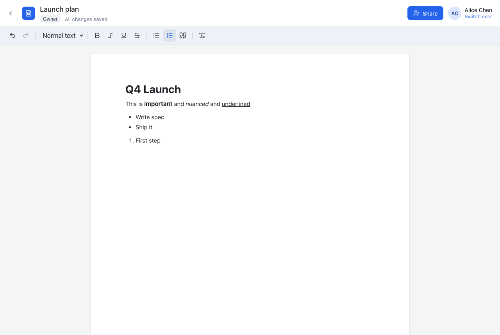

# Ajaia Docs

A lightweight collaborative document editor inspired by Google Docs. You can create and rich-text edit documents, import `.txt` / `.md` / `.docx` files, share documents as **viewer** or **editor**, and come back later to find everything saved.

**Live demo:** https://ajaia-assignment-8kk8.onrender.com. It's hosted on Render's free tier, which sleeps when idle, so the first load can take up to ~1 minute.

**Source:** https://github.com/s-maverick/ajaia-assignment · **Walkthrough video:** https://www.loom.com/share/be47c77719c848508a28d1d18639b16b



## Demo accounts

Authentication is mocked: pick an account on the sign-in screen (no passwords).

| User | Email | Seeded access |
|------|-------|---------------|
| Alice Chen | `alice@ajaia.test` | Owns "Welcome to Ajaia Docs" |
| Bob Martinez | `bob@ajaia.test` | **Editor** on the welcome doc |
| Carol Okafor | `carol@ajaia.test` | **Viewer** on the welcome doc |

**Testing sharing:** sign in as Alice in one browser and Bob in another (or a private window). Each browser holds one session. You can also use **Switch user** in the top-right.

## Features

| Area | What works |
|------|-----------|
| Documents | Create, rename (click the title), edit, delete (owner only). Autosaves ~1s after you stop typing. `⌘/Ctrl+S` saves now. Shows a saving / saved / error status. |
| Rich text | Bold, italic, underline, strikethrough, Heading 1–3, bulleted and numbered lists, quotes, undo/redo, clear formatting. Markdown-style shortcuts like `# `, `- `, `1. ` and `**bold**` also work. |
| File import | **`.txt`, `.md`, `.docx` up to 5 MB.** Each upload becomes a new editable document owned by you, and the formatting (headings, lists, bold/italic/underline) carries over. Other file types get a clear error. Images and tables in `.docx` are not supported; table text is kept as paragraphs. |
| Sharing | The owner shares by email as **Can edit** or **Can view**, and can change or remove access. The dashboard splits **My documents** (with a Private / Shared-with-N badge) from **Shared with me** (with the owner's name and your role). Viewers get a read-only editor. |
| Persistence | SQLite via libSQL. Documents, formatting (stored as sanitized HTML) and sharing survive refreshes and restarts. |
| Concurrent edits | Each save checks the document version. If someone else saved first, you **don't silently overwrite them**: a banner offers *Load their version* or *Keep mine*. |

## Run locally

Requires **Node.js 22.12+** (tested on 22 and 25).

```bash
npm install
npm run dev          # API on :3001 + Vite dev server on :5173
```

Open http://localhost:5173. On first start the app creates `data/ajaia-docs.db` and seeds the demo users and a welcome document. Delete the `data/` folder to reset.

Production-style run (one process serves both the API and the built frontend):

```bash
npm run build
npm start            # http://localhost:3001
```

### Tests

```bash
npm test             # 19 API + import tests (Vitest + Supertest, throwaway SQLite DB)
npm run typecheck
npm run test:e2e     # optional: full browser journey in your local Google Chrome
```

`npm test` covers auth, owner/editor/viewer access rules (including 404 vs 403), HTML sanitization, the version-conflict 409, input validation, and `.txt`/`.md`/`.docx` conversion. The `.docx` test builds a real file in memory.

`npm run test:e2e` builds the app, starts it on a temporary DB and walks through this flow in Chrome:

1. Create and format a document, then reload to check it persisted.
2. Share it, then check that the viewer is read-only.
3. Upgrade to editor and trigger an edit conflict.
4. Import a file and reject an unsupported one.
5. Check the no-access page.

It uses your installed Chrome via `playwright-core`, so there's no browser download. Set `CHROME_PATH` if Chrome isn't detected.

### Environment variables

See `.env.example`. All are optional locally.

| Variable | Default | Purpose |
|----------|---------|---------|
| `PORT` | `3001` | HTTP port |
| `SESSION_SECRET` | dev value | Signs the session cookie. **Required in production.** |
| `DATABASE_URL` | `file:data/ajaia-docs.db` | Local SQLite file, or `libsql://…` for a hosted Turso DB |
| `DATABASE_AUTH_TOKEN` | none | Turso auth token |

## Deploy (Render + Turso, both free)

The repo includes a Render Blueprint (`render.yaml`). It deploys a single Node web service that builds the frontend and serves it from Express.

1. **Database (recommended).** Render's free web services have an ephemeral disk, so a local SQLite file resets whenever the service sleeps or redeploys. Create a free [Turso](https://turso.tech) database instead:
   ```bash
   turso db create ajaia-docs
   turso db show ajaia-docs --url      # -> DATABASE_URL
   turso db tokens create ajaia-docs   # -> DATABASE_AUTH_TOKEN
   ```
   (or use the Turso web dashboard).
2. Push this repo to GitHub. In Render, choose **New → Blueprint**, select the repo, and enter `DATABASE_URL` and `DATABASE_AUTH_TOKEN` when prompted. Render generates `SESSION_SECRET` automatically.
3. When the deploy finishes, open the `.onrender.com` URL. The schema and demo data are created on first boot.

If you skip step 1, the app still works but falls back to an ephemeral SQLite file: data resets to the seed whenever the instance restarts.

## Project layout

```
server/            Express API (TypeScript, run with tsx)
  app.ts           app factory: middleware, routes, SPA hosting
  db.ts            libSQL client, schema, seed data
  auth.ts          mocked auth: signed httpOnly cookie
  access.ts        role resolution + single authorization check
  html.ts          HTML sanitizer allowlist, text→HTML
  importers.ts     .txt / .md / .docx → sanitized HTML
  routes/          auth + documents/sharing endpoints
src/               React frontend (Vite)
  pages/           Login, Dashboard, Editor
  components/      Toolbar, ShareDialog, header, icons
  hooks/useAutosave.ts   debounced single-writer autosave + conflict handling
tests/             Vitest API/import tests, e2e/ browser smoke test
docs/              Architecture note, AI workflow note, video script, screenshots
```

## Status

**Working end to end:** everything in the Features table above, verified by automated tests and a browser run.

**Intentionally not built:**
- Real-time co-editing and presence. Conflicts are detected and resolved explicitly instead.
- Real authentication.
- Comments and version history.
- Images and tables.
- Importing into an existing document.
- Export.

The reasons are in [docs/ARCHITECTURE.md](docs/ARCHITECTURE.md).

**Next 2–4 hours:**
1. **Version history.** Every save already increments a version, so this means storing snapshots and adding a restore UI.
2. **Export** to Markdown / `.docx`.
3. **"New version available" notice** for open editors (polling or SSE), before attempting full real-time collaboration.
4. **Import into the current document,** in addition to creating a new one.
5. Run the e2e test in CI (GitHub Actions).

More docs: [Architecture note](docs/ARCHITECTURE.md) · [AI workflow note](docs/AI_WORKFLOW.md) · [Submission contents](SUBMISSION.md)
